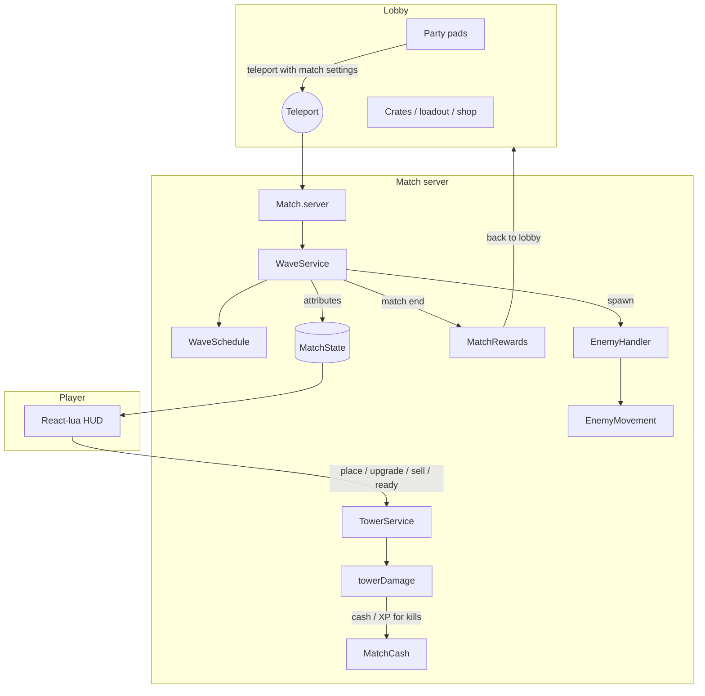

# Sky Island Tower Defense 🏰

Hi! This is part of the code of my Roblox game. I made this repo so people can see how it works inside.

## About the game

It's a co-op tower defense. Up to 4 players meet in the lobby, stand on a party pad and get teleported into a match together.
In the match you place and upgrade towers to hold off 15 waves. There are elites, enemies that split when they die,
and a big boss (the Colossus) at the end. After the match everyone gets coins, gems and XP and goes back to the lobby,
where you can open crates to unlock new towers and set up your loadout.

It works on PC and on phones. I made the whole game by myself.

## What's in this repo

This is not the full game, only some parts of it:

| Part | Where | What it is |
| --- | --- | --- |
| Waves | `src/match/server/Services/WaveService/` | Runs the match: waves, timers, match settings, and the tests for it |
| Enemy movement | `src/match/server/Services/Enemy/EnemyMovement.luau` | How enemies walk the path, with timeouts so they never get stuck |
| UI | `src/shared/Source/Features/App/` | The game UI in React-lua: match HUD, towers inventory and upgrades, crates, rewards, victory screen, lobby HUD |
| Tools | `tools/` | My checks and Python scripts that run playtests in Roblox Studio |

I left out the stuff that would help cheaters or people who want to copy the game: tower combat, the economy and
saved data, the server checks, purchases, admin tools and the balance numbers. So this code won't build on its own.

## How it works

`WaveService`, `WaveSchedule` and `EnemyMovement` are in this repo, the rest is private.

A few rules I follow in the whole game:

- **The server decides everything.** The player only asks ("place a tower here"), and the server checks if it's
  allowed and if you have the cash. Cash is taken before the tower appears.
- **The UI only shows real numbers.** It reads what the server publishes (wave, enemies alive, time left, ready votes),
  it never makes numbers up.
- **Everything is per player.** Cash, tower limits and rewards are separate for each player, so if someone leaves
  in the middle of a match it doesn't break it for the others.
- **No endless loops.** Every wait has a timeout, and stuff that isn't needed anymore gets cleaned up.

## Testing

I wanted to be sure updates don't break the game, so I set up some testing:

- **Unit tests** in `WaveService/Tests.luau`. They run on the server in Studio and check things like settings,
  enemy stats, the wave order and the total kills and income for a full match, so if I change the balance by
  accident the test fails.
- **Real playtests from the terminal.** Roblox Studio has a built-in MCP server, and my Python scripts in `tools/studio/`
  talk to it. `playtest.py` starts the game, runs the tests, places a tower, tries some bad placements
  (they must be rejected without taking cash), waits until wave 1 is cleared, takes a screenshot and checks the console for errors.
- **Phone check.** `phone_preview.py` opens the HUD at phone sizes so I can see if something overlaps.
- **Performance check.** `perf_probe.py` fills a match with towers and enemies and measures the frame times.
- `tools/check.sh` runs the linter ([selene](https://github.com/Kampfkarren/selene)) and builds both places with Rojo.

## Tech

- Luau on Roblox (server and client)
- [Rojo](https://rojo.space) to work in VS Code instead of Studio, with two places: `default.project.json` (match) and `lobby.project.json` (lobby)
- [Wally](https://wally.run) packages: React-lua, Promise, Networker, ProfileService
- [Rokit](https://github.com/rojo-rbx/rokit) for tool versions
- Python for the Studio scripts

## License

All rights reserved. You can read the code, but please don't copy it or use it in your own projects. See [LICENSE](LICENSE).

---

Made by [Kirill](https://github.com/Ar7ti) · [Play Sky Island Tower Defense](https://www.roblox.com/games/86140743290043/Sky-Island-Tower-Defense) 🎮
