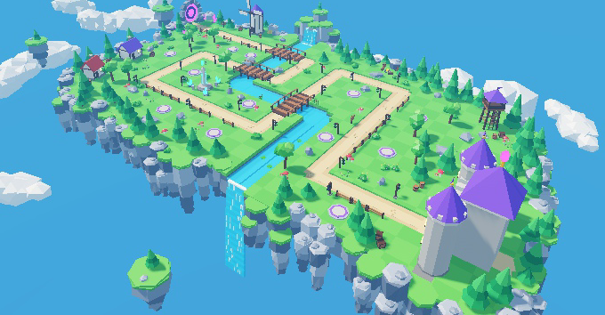
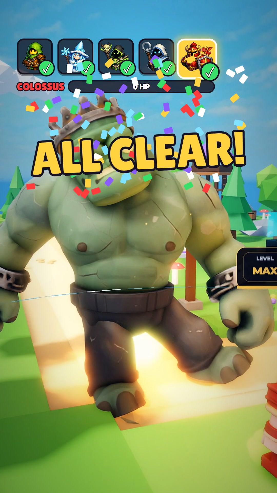
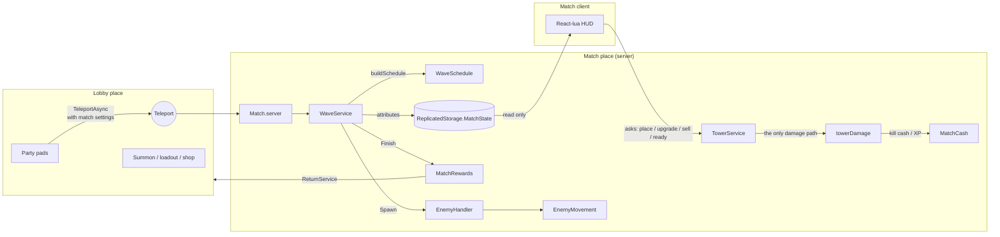

<div align="center">

# Sky Island Tower Defense: source showcase

**A co-op Roblox tower defense game, built in Luau with Rojo, Wally and React-lua.**
This repository shows selected parts of the game's source code as a portfolio piece.

[](https://www.roblox.com/games/86140743290043/Sky-Island-Tower-Defense)




</div>

## The game

Up to four players gather on a party pad in the **lobby**, pick a map and get teleported together to a
**match** server. There they hold off 15 waves of enemies (elites, splitting Bloaters and a Colossus boss)
by placing and upgrading towers from their loadout. When the match ends, everyone gets coins, gems and XP
and is sent back to the lobby, where towers are unlocked from crates and arranged into a loadout.

It runs on desktop and on phones, and the in-game UI is built with React-lua.



**What this repository includes:**

| Area | Files | What to look at |
| --- | --- | --- |
| Match flow | `src/match/server/Services/WaveService/` | The wave lifecycle and the state it publishes to the HUD, schedule validation, match settings with input sanitising, and server unit tests |
| Enemy movement | `src/match/server/Services/Enemy/EnemyMovement.luau` | Waypoint walking with time-outs, retries and knock-back along the path |
| UI | `src/shared/Source/Features/App/` | React-lua components: the match HUD, unit inventory and upgrades, summon crates with a 3D opening, rewards, the victory screen, the lobby HUD and shared hooks |
| Tooling | `tools/` | Lint and build checks, plus Python drivers that run real playtests in Roblox Studio |

This is an **excerpt**, not the full game. Things that would help cheaters or cloners are left out:
tower combat, the economy and saved data, remote-call validation, purchases, admin tools and balance data.
It will not build by itself, since the files it requires are not all here.

<br clear="right">

## Architecture



`WaveService`, `WaveSchedule` and `EnemyMovement` are in this repository. The other boxes stay private.

### Server-authoritative by design

Each rule below holds for every change to the game:

1. **The client only asks.** Every remote call is checked on the server: argument types, who owns what, the
   price and the position. Cash is spent before the effect happens, with no yield between paying and applying.
2. **The HUD tells the truth.** It shows only what the server published: `MatchState` attributes (`Phase`, `Wave`,
   `Alive`, `TimeRemaining`, `ReadyVotes`...), player attributes and network events. The client never invents a number.
3. **Each rule is per player.** Cash, tower limits and rewards (paid once per `UserId`) are tracked for each player,
   so a player who leaves or joins mid-match never breaks the match for the others.
4. **Everything is bounded.** Every loop and wait has a time-out (see `WaveService:Wait` and `EnemyMovement.moveTo`),
   connections get disconnected, and temporary instances get destroyed.
5. **Saved data only grows.** New profile fields are added with defaults. Existing fields are never renamed or removed.

A small example from `WaveService:Publish`: the `Phase` attribute is written last, so a UI subscriber to `Phase`
always reads the other values already updated.

## Tests and Studio automation

**Unit tests.** `WaveService/Tests.luau` runs on the server inside Studio. It checks that settings resolve and
fall back to defaults on bad input, that enemy stats scale exactly once, that shared config is never mutated,
and that the wave schedule is ordered and rejects invalid groups. It pins the economy totals: changing the
balance by accident fails the test. It also runs an isolated `WaveService` instance with fake signals, to check
that a death followed by a destroy resolves only once and that a stopped match never keeps spawning.

**Real playtests from the command line.** Roblox Studio has a built-in MCP server (`StudioMCP`). The scripts in
`tools/studio/` talk to it over JSON-RPC, with no plugin needed:

| Script | What it does |
| --- | --- |
| `studio_mcp.py` | Finds the open Studio window by place name, runs Luau or a batch of steps, saves screen captures, and retries when the Studio link drops |
| `push_sources.py` | Reads a Rojo sourcemap and writes repository files into the open place through `ScriptEditorService`, for when Rojo isn't connected |
| `playtest.py` | **The release gate.** Starts Play and runs the unit tests. Places a tower through the live `TowerService`. Checks that bad positions (NaN, on the path, out of range, wrong type) are rejected *without taking cash*, and that upgrade and sell prices are exact. Waits for wave 1 to be cleared, takes a screenshot, scans the console for errors and prints a JSON verdict |
| `phone_preview.py` | Mounts the HUD at phone resolutions with touch mode on and captures each one, to catch overlaps and clipping |
| `perf_probe.py` | A crowded match (N towers, M enemies). Samples the server Heartbeat and client frame times (p50 / p95 / max) to compare runs before and after a change |

Test runs never write match rewards into the tester's saved profile (`NoProgress` guard), and the tools never
save or publish the place.

**Static checks.** `tools/check.sh` runs [selene](https://github.com/Kampfkarren/selene) (0 errors, and warnings may not
grow) and a `rojo build` of both places. A change is done only when the static checks and the playtest both pass.

## Tech stack

- **Luau** (typed where it pays off) on Roblox, for the server and the client
- **[Rojo](https://rojo.space)** 7 maps the file system to the two places: `default.project.json` (match) and `lobby.project.json` (lobby)
- **[Wally](https://wally.run)** packages: React-lua and ReactRoblox 17, Promise, Networker, DataServiceTyped, ProfileService
- **[Rokit](https://github.com/rojo-rbx/rokit)** pins the tool versions (rojo, wally, selene)
- **Python 3** for the Studio automation, run with `python -I`

## Repository layout

```
src/
  match/server/Services/
    WaveService/   WaveService.luau, WaveSchedule.luau, MatchSettings.luau, Tests.luau
    Enemy/         EnemyMovement.luau
  shared/Source/Features/App/
    Common/        Theme, Panel, GameButton, UiScale, useIsTouch, usePlayerAttribute, ...
    MatchHud/      wave/level bars, READY vote, elite alerts, tutorial coach, match menu
    Units/         inventory, unit cards, filters, tower hotbar, upgrades, placement hints
    Summon/        crate list, odds, 3D crate opening, reveal
    Rewards/ Victory/ Notifications/ Lobby/Hud/   and RootUI.luau
tools/
  check.sh         selene + rojo build gate
  studio/          StudioMCP drivers (playtest, push_sources, phone_preview, perf_probe, ...)
```

## License

**All rights reserved.** The source is published so it can be read and reviewed as a portfolio. You may not copy,
modify, redistribute or use it in other projects. See [LICENSE](LICENSE). The game, its name and its art belong to the author.

---

Made by [Ar7ti](https://github.com/Ar7ti) · [Play Sky Island Tower Defense on Roblox](https://www.roblox.com/games/86140743290043/Sky-Island-Tower-Defense)
